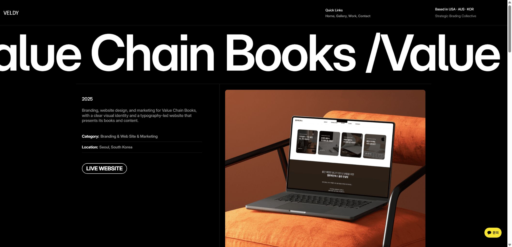
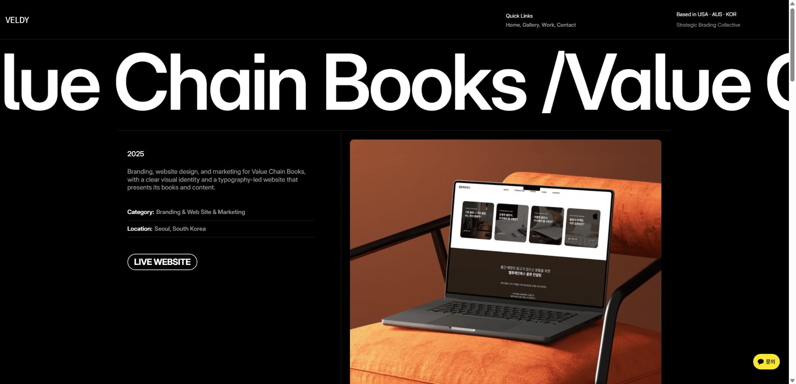

# 먼데이 홈페이지 피드백 반영 기록

- 작업일: 2026-10-26
- 원본: [밸디 홈페이지 수정 사항 — 10/16 수정 요청 사항](https://veldyofficials-team.monday.com/boards/5030803126/pulses/2883622385)
- 근거: 댓글 8개와 각 댓글의 첨부 이미지 8장.
- 범위: 메인 HTML 4개, `work/*.html` 18개, `article/*.html` 4개 및 공용 보정 스크립트. `/profile` 파일은 수정하지 않았으며, 해당 페이지에서 이번 공용 스크립트를 참조하지 않는 것도 확인했다.
- 로컬 파일 반영 완료. 배포 및 먼데이 댓글/상태 변경은 하지 않았다. API 키는 소스와 이 문서에 저장하지 않았다.

## 요청별 변경 사항

| 댓글 | 요청 | 반영 내용 | 상태 |
| --- | --- | --- | --- |
| 142623291 | 오른쪽 아이템들을 아래로 정렬 | `veldy-partners.js`의 `.vp-sub-layout`을 `align-items:start`에서 `end`로 변경. 기존 모바일 1열 배치는 유지. | 완료 |
| 142623288 | 구독 안내 문구 원문·문맥 확인 | 스크린샷의 문구가 현재 코드에도 동일하게 있는 것을 확인. 문장을 자연스럽게 정리하고, 별도 근거 없는 자유로운 중단·보험 부담 면제 표현을 제거. 별도의 과거 승인 원문은 확보되지 않았으므로 원문 복원으로 표기하지 않음. | 문구 수정 완료 |
| 142623289 | LIVE WEBSITE 불발 링크 확인 | BIBIMCHA에는 유효한 목적지가 없어 버튼을 표시하지 않음. 표시되는 외부 목적지 9개에 대해 HTTP 응답 확인. 모빌테크가 드림유 치과 주소로 연결되는 오류를 발견해 버튼 숨김. Framer 로딩 후 내부 경로가 확장자 없는 주소로 바뀌는 문제를 `.html` 경로로 보정. | 점검·오연결 차단 완료, 미확정 주소 대기 |
| 142623292 | 델타항공 기간 2년, 그래픽 디자인, 웹사이트 삭제, 포스터·브로슈어 목업 추가 | 카테고리 `Creative Direction` → `Graphic Design`, LIVE WEBSITE 버튼 숨김, 남아 있던 템플릿 제목 `Halo Wear` → `Delta Air Lines`. 기간은 아래의 후속 ‘모두 제거’ 요청을 우선 적용. 목업 원본은 저장소에서 식별되지 않아 기존 이미지를 유지. | 코드 완료, 목업 자료 대기 |
| 142623293 | Branding & Web Site & Marketing, 기간 모두 제거 | 밸류체인 카테고리를 지정 문구로 수정. Work 상세 18개 전체에서 Duration 행과 해당 행의 구분선이 화면에 나타나지 않도록 공통 CSS 적용. | 완료 |
| 142623290 | 날짜는 연도만 | Work 상세 18개 HTML의 날짜 표시를 연도만으로 변경. Framer 재렌더링 뒤에도 `datetime`의 연도를 기준으로 표시하도록 보정. | 완료 |
| 142623295 | 밸류체인 영문 확인 | 템플릿 제목 `Arc & Bloom` → `Value Chain Books`. ‘digital library’를 만들었다는 기존 설명을 요청된 브랜딩·웹사이트·마케팅 범위에 맞게 수정. | 완료 |
| 142623294 | EMAIL ME를 Contact로 변경, 문의창 열기 | 이메일 CTA를 CONTACT로 변경하고 기존 PROJECT INQUIRY 모달에 연결. 상세·아티클 페이지에서 빠져 있던 모달 스크립트 추가. 하위 경로의 Contact 링크도 지원하고 중복 Contact 표시 방지. | 완료 |

### 수정한 구독 설명

기존:

> 한 명을 채용하는 비용으로 브랜딩·디자인·마케팅·콘텐츠 전문가 팀 전체를 매월 구독합니다. 필요한 만큼 쓰고, 필요 없을 땐 멈추면 됩니다 — 채용·4대보험·관리 부담 없이.

변경:

> 한 명을 채용하는 비용으로 브랜딩·디자인·마케팅·콘텐츠 전문가로 구성된 팀과 함께하세요. 필요한 기간 동안 월 구독으로 이용하며, 채용과 인력 관리에 드는 부담을 줄일 수 있습니다.

### 수정한 밸류체인 설명

> Branding, website design, and marketing for Value Chain Books, with a clear visual identity and a typography-led website that presents its books and content.

## 구현 위치와 방식

- `assets/js/veldy-partners.js`: 구독 문구와 아이콘 영역 정렬.
- `assets/js/veldy-inquiry.js`: 하위 경로 Contact 트리거 지원, 기존 히어로 Contact의 과거 GitHub 주소 하드코딩을 현재 설치 경로 기준으로 변경.
- `assets/js/veldy-contact.js`: 푸터에 Contact CTA가 있는 경우 별도 중복 Contact를 추가하지 않음.
- `assets/js/veldy-feedback.js`: Framer가 HTML을 재렌더링한 뒤 연도·제목·카테고리·설명·버튼·내부 링크를 유지. 실제 변경이 필요한 요소만 수정하고 MutationObserver 호출을 프레임 단위로 합침.
- `work/*.html`: 연도 표시, Duration 숨김 CSS, 페이지별 JSON 설정, 공용 스크립트 로딩. 델타항공·밸류체인은 초기 HTML의 제목/내용도 수정.
- 루트 및 `article/*.html`: 문의창과 공용 보정 스크립트 로딩, 변경된 스크립트 캐시 버전 갱신.
- `scripts/apply-monday-feedback.py`: 동일 정적 내보내기에 보정을 재적용하는 스크립트. Python과 `beautifulsoup4` 필요. 재실행 시 변경 파일 목록 `[]` 확인. 각 페이지의 기존 외부 주소를 읽으므로, 추후 주소 수정 시 HTML과 `veldy-feedback-config`를 함께 확인할 것.
- `scripts/link-audit.json`: 외부 목적지 HTTP 점검 결과.

Duration 값은 원본 HTML 데이터에 남기고 표시 행을 숨겼다. 화면에서 제거하되, 원본 기록을 잃지 않도록 했다. 목적지가 없는 LIVE WEBSITE 역시 표시를 숨기며 새 주소를 임의 생성하지 않았다.

## 검증 결과

- 수정 JavaScript 4개 `node --check` 통과.
- Work 18개: 초기 HTML의 연도 표시, Duration 숨김 CSS, 페이지별 설정, 문의창 스크립트 존재 확인.
- 대상 HTML 26개: 정적 내부 링크가 가리키는 로컬 경로 누락 0건.
- 외부 LIVE WEBSITE 목적지 9개 모두 HTTP 200. 성동화학은 `sungdongchemical.imweb.me`로 리다이렉트됨. HTTP 성공은 페이지의 모든 기능이나 Instagram 로그인 없이 전체 콘텐츠 열람을 보장하는 검사는 아님.
- 브라우저: 밸류체인 제목·카테고리·설명·2025 연도·기간 비표시·CONTACT 라벨 확인.
- 브라우저: 델타항공 제목·Graphic Design·연도·기간 비표시·웹사이트 버튼 숨김 확인. 모바일 구간에서도 해당 표시와 문의창 열기/닫기 확인.
- 브라우저: BIBIMCHA의 유효하지 않은 LIVE WEBSITE 버튼이 표시되지 않음. JJJD도 연도 및 기간 비표시 확인.
- 브라우저: 홈 구독 문구 변경 확인. 데스크톱 좌우 영역 하단 좌표 차이 약 0.001px로 정렬 확인.
- 문의창: 상세 페이지에서 CONTACT 클릭 → 모달 표시 → 닫기 동작 확인. 실제 문의 메일 전송은 수행하지 않음.
- 검증 중 Framer 라이브러리의 `Assertion Error: nextVariant should be defined` 로그가 관찰됨. 이번 피드백의 표시·모달 동작은 확인했으나, 사이트 전체 애니메이션의 무오류를 보장하는 검증은 아님.

## 남은 자료 및 확인 사항

1. **델타항공 목업:** 조이님이 보유한 실제 포스터·브로슈어 디자인 원본이 필요. 제공 전에는 다른 브랜드 이미지나 임의 생성물을 실제 작업물처럼 넣지 않았다. 이번 작업에서 조이님에게 메시지를 보내지는 않았다.
2. **모빌테크 웹사이트:** 기존 `https://litt.ly/dreamudental`은 다른 프로젝트 주소이므로 숨김. 올바른 주소가 확인되면 해당 페이지의 `website` 설정과 링크에 반영할 것.
3. **기간 우선순위:** 델타항공 2년 요청 뒤에 작성된 ‘듀레이션은 모두 뺄게요’를 전체 Work 상세에 적용. 델타항공만 예외로 표시해야 한다면 별도 조정 필요.

## 화면 증빙

